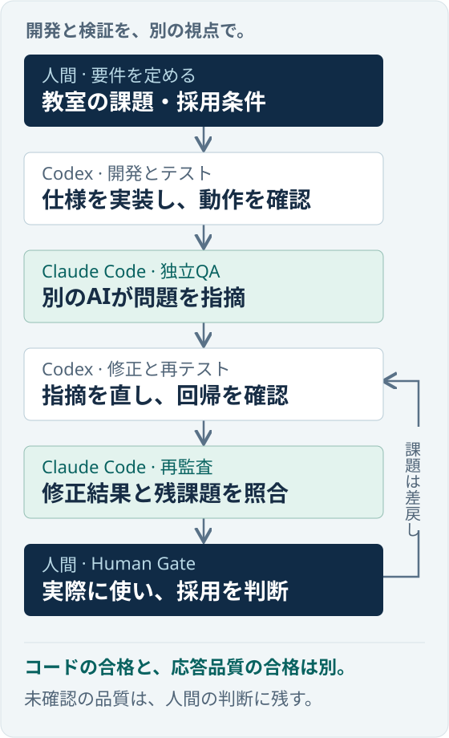

# Dual-AI QA 技術実証レポート

## 小さな教室で、AIが作ったものをどう確かめるか

岩手県北上市のこむぎパソコン教室は、教室運営・学習支援アプリ「KOMUGI Classroom DX」の開発で、Codexによる実装とClaude Codeによる独立QAを組み合わせています。QAは、仕様どおりに動くか、見落とした問題がないかを確認する活動です。本レポートでは、この分業を「Dual-AI QA」と呼びます。

出発点は、講師1人に集中していた紙の進捗記録、教材ファイルの準備、授業後の片付けです。生徒が「次はどこから学ぶか」を分かりやすくし、講師の負担を減らすために開発を始めました。AIに実装を任せても、授業で使えるかという判断は残ります。そこで、実装、別のAIによる確認、人間による試用を分け、指摘と修正を記録しました。

**確認できたのは、問題を発見し、修正し、再確認する工程を実際に繰り返したことです。** 業務時間の削減効果や教育効果の定量測定は未完了です。AIを2つ使うこと自体が、誤りのない品質を保証するわけではありません。

出典：開発構想・仕様原典、公開用の[根拠資料](evidence.html#sources)。対象期間は2026年11月17〜22日の開発・QA記録です。

## Codex・Claude Code・人間の役割

| 担当 | 実施したこと | 判断の範囲 |
|---|---|---|
| Codex | 仕様整理、実装、指摘への修正、自動テスト、HTTP・Windows起動などの動作確認 | 実装と検証の証拠をそろえる |
| Claude Code | 候補コード・仕様・テストの静的監査、修正後の再監査、実AI応答のブラインド評価 | 別のAI・別の評価工程で所見を返す |
| 人間（教室側） | 要件の決定、実機での試用、実AI通信の承認、教材・授業利用の採否 | 使いやすさ、教育上の妥当性、採用を判断する |

「独立」は、外部認証機関による監査という意味ではありません。記録されたコード監査では、Claude Codeの編集・実行ツールやMCP・hooksを無効にした読み取り専用の工程を用いています。ClaudeがCodexのテストをそのまま再実行したわけではありません。モデル名や実行条件も記録し、Issue #8では返却メタデータから `claude-opus-5-5` を確認しています。

## 開発から人間による確認まで

1. 人間が目的と仕様を定め、Codexが実装候補とテストを作る。
2. Claude Codeが対象資料を独立に読み、問題と重大度を報告する。
3. Codexが指摘を確かめ、修正と回帰テスト（既存機能が壊れていないかの確認）を行う。
4. 修正した候補を再監査し、残った問題と確認範囲を記録する。
5. 人間が実際の利用条件で確認する「Human Gate」で、授業への採否を判断する。問題があれば再び修正へ戻る。

実AIの文章品質を評価したIssue #7では、架空の2題材を使用しました。実行結果を固定し、Codexの所見を先に保存したうえで、モデル名・過去の報告・Codexの評価・採用判断をClaudeに渡さず評価しました。入力・出力のハッシュによる同一性確認も記録されています。ただし評価対象はアプリ処理後の保存応答で、モデルの未加工の応答やトークン使用量は保存していません。

## 実際に見つかり、修正した問題

### 保存されていないのに、利用者が気づけない

初期の独立監査を受け、ログインの有効期限が切れた後の保存要求に「入力内容は保存されていません」と通知する処理を追加しました。日付が変わった際に、前日の未完了授業を当日の授業として扱う問題も修正しました。

修正前に固定受入テストの4ケースが失敗し、修正後は成功した記録があります。初期監査はHigh 0・Medium 5・Low 7、修正後の最終再監査はHigh 0・Medium 0・Low 2です。High／Medium／Lowは監査時点の重大度であり、全期間の不具合総数ではありません。関連コミット：`e3e04fd`。[公開監査抜粋](evidence.html#cases)

### 日本語の途中入力が、余分に減点される

日本語タイピングで、途中終了時に未入力の後半まで誤りとして扱う問題を修正しました。全角・半角の区切り空白を同じように扱い、日本語変換を確定するEnterで送信される問題も防ぎました。

初回監査のMedium 2件は再監査で0件となり、全138ケース成功を記録しています。これは当時の静的監査と自動テストの結果です。Claude自身が実ブラウザを操作した確認ではありません。関連コミット：`e0f6bce`。[公開監査抜粋](evidence.html#cases)

### 授業を止めず、保存失敗から戻れるようにする

教室側の試用を起点とするIssue #2では、講師と生徒のセッションを分離しました。独立QAでは、別タブの操作後の保存復旧や起動処理も確認し、保存失敗後5分以内に同じ生徒が再ログインした場合の未保存内容の復旧、正しいサーバーの再利用、授業後の明示更新へと修正しました。

初回Medium 3件は全体再監査・差分監査で0件となり、全152ケース成功を記録しています。実Chromeの別タブ操作感は当該記録では未確認です。関連コミット：`bb4bcbc`。[公開監査抜粋](evidence.html#cases)

### コードを直しても、AIの回答品質は別に測る

Issue #7のブラインド評価では、別案を求めても本文が出ない、本人が指定していない将来の約束を文章に含める、応答待ちの負担がある、というMedium 3件が残りました。後続のIssue #8で、完成文を求める指示、本人の事実と仮案の区別、失敗時の再送と待機中の終了操作を修正しました。

Issue #8の最終コードQAはHigh 0・Medium 0・Low 3、範囲外持ち越し3件。全200ケースは成功しています。一方で、**修正後の実AI通信は0回です。実際の回答品質のMedium 3件が解消したとは確認していません。** Gemmaの正式採用・授業利用のHuman Gateは保留です。関連コミット：`520b872` → `47d8208`。[公開監査抜粋](evidence.html#cases)

## テスト・監査の集計と数え方

集計基準日：**2026年11月22日（JST）**。参照コミット：`47d820885f6f5fd28a225fbf8829a231550d2044`。既存累計レポートを出発点に、同じコミットのSTATUS・監査資料・履歴と、限定した監査結果メタデータを照合しました。製品テストや実AI通信を今回再実行した数ではありません。

| 指標 | 掲載値 | 単位・意味 |
|---|---:|---|
| 主要自動テストの延べケース実行数 | 2,970件 | 記録された37行の主要実行結果の合計。同じケースの繰り返しを含む |
| 記録された主要テスト実行 | 37回分 | 集計表の記録単位。全コマンド実行回数を網羅するものではない |
| 最新のテストケース数 | 200件 | 最終の全体テスト数。固定受入5件を含み、205種類とは数えない |
| 独立QA起動 | 少なくとも43回 | 既存レポート40回に、今回確認した過去の3回を追加 |
| 独立QAの結果取得 | 少なくとも41回 | 所見を取得した回。合格回数という意味ではない |
| 独立QAの結果未取得 | 2回 | 利用上限1回・出力上限1回。合格に換算しない |
| Human Gate起点の修正対応 | 10対応 | 明示された5対応＋Issue #1〜#5。バグ数・受入合格数とは異なる |
| アプリから実Cloudflare LLMへの呼び出し | 少なくとも170回 | 重複を避けて確認できる試験群の下限。全期間の正確な総数ではない |

**集計の補正：** 既存レポートの独立QAは40回起動・38回結果取得・2回未取得です。今回、初期タイピングの監査2回と初期Medium修正の途中監査1回の計3回を追加確認しました。新しいQAを3回実行した意味ではありません。[追加確認の根拠](evidence.html#correction)と[全件台帳](evidence.html#ledgers)を公開しています。

自動テスト、監査起動、修正対応、実AI呼び出しは単位が異なるため合算しません。固定受入テストの別実行や途中の失敗・再実行、Windows・ブラウザの手動確認は2,970件に上乗せしていません。実Cloudflare通信にはCodexやClaudeの開発・監査用通信を含めず、全AIサービスを通じた総呼び出し数は未集計です。

### 実AI応答の品質評価は、小標本として読む

| Issue #7の指標 | 観測結果 | 注意点 |
|---|---|---|
| 実通信 | 20回、18成功・2タイムアウト | 再送2回は20回の内数で、両方成功 |
| 120文字の依頼 | 許容108〜132文字で5/5 | 厳密に120文字は0/5 |
| 短縮の依頼 | 2/2で短縮 | あらゆる文章での性能を示さない |
| Claudeの応答品質評価 | High 0・Medium 3・Low 6 | コードQAの件数と合算しない |
| 未実施の会話 | 家族題材の9・10往復目 | 通信予算到達で停止した |

Issue #5ではコード上の指摘を改善しても、実モデルの品質評価にHigh 2・Medium 2が残っています。条件や評価対象が異なる各回の数字をつなげ、モデル間の統計的優位や品質改善率を示すことはできません。

## 確認できた成果と、残る課題

実装担当と別のAIの指摘を往復させ、保存、認証、入力、起動、AI利用中の復旧といった具体的な問題を修正できました。人間の試用でも仕様・操作のずれが見つかり、10対応の改善コード等が記録されています。ただし、10個の不具合が完全に解消したという集計ではありません。

最新コードQAのLow 3件には、長い回答の末尾が自然に終わる保証がないこと、指示が重なる場合の解釈余地、専用固定テストの網羅不足があります。範囲外の持ち越し3件は、失敗を含む受講総試行上限、期限切れ時の未送信本文復元、モデル名の大文字扱いの不一致です。[残課題の詳細](evidence.html#limits)

今後は、承認した条件での実応答再測定、講師同席での操作確認、実受講生の理解や文章の自然さの確認が必要です。Issue #7での題材外・個人情報・Office操作に関する攻撃的入力への耐性、負荷条件、長期間の障害率は未確認です。通常のMistral設定は維持しており、Gemmaの正式採用や製品本番公開を完了したという報告ではありません。

## 根拠を読める形で公開する

公開用の集計台帳、監査抜粋、補正理由、原資料のファイル名・行番号・参照コミットを[根拠資料ページ](evidence.html)にまとめました。非公開の原ログや受講者情報は含めていません。公開資料は原記録の抜粋・要約であり、第三者が全試験を再実行できる完全なログ一式ではありません。

- [報道向けプレスリリース](press.html)
- [技術実証レポートのMarkdown原稿](report.md)
- [集計台帳と監査抜粋](evidence.html)
- [今後の更新手順](UPDATE.md)
- [Publicリポジトリ](https://github.com/suguruwada0612-ship-it/dual-ai-qa-report)

発信：こむぎパソコン教室（岩手県北上市）。公開・更新日：2026年11月22日。お問い合わせ：[公式サイト](https://komugi-pc-school.tank.jp/)に掲載の `info@komugi-pc-school.tank.jp` ／ 0197-62-6113。公式窓口は2026年11月22日に確認しました。
